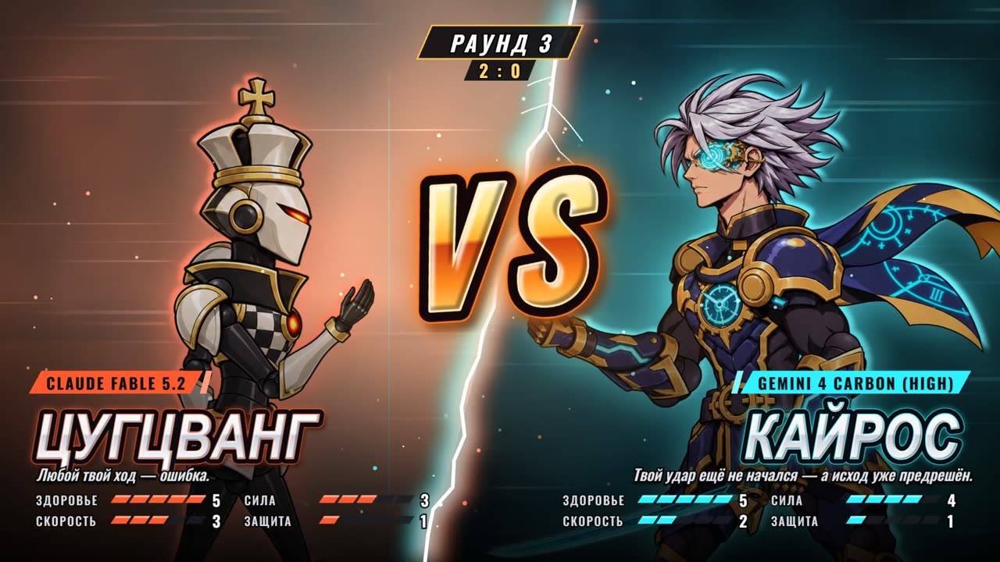
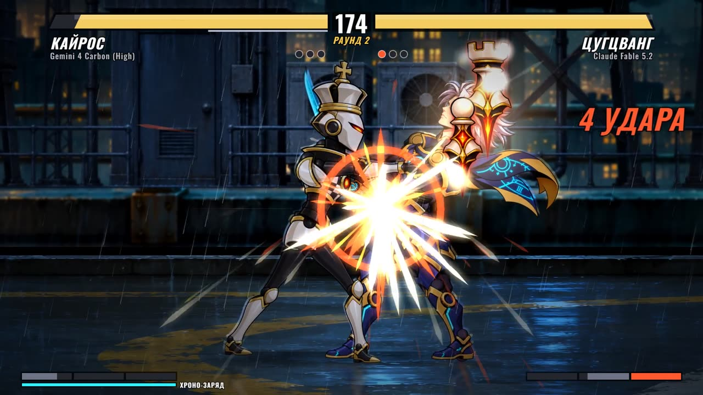

# Ринг моделей



2D-файтинг один на один, где бойцов целиком создают нейросети. Обе модели получают один и тот же короткий промпт «создай бойца и победи в турнире», а дальше всё делают сами: персонажа и предысторию, картинки частей тела на общем скелете, анимации, приёмы, способности кодом, суперприём, голос и мозги, которые ведут бойца в бою. Между раундами раздевалка: модель смотрит запись своего боя и дорабатывает бойца.

Ролик про первый турнир: [Claude Fable 5.2 против Gemini 4 Carbon](https://youtu.be/c_nvAFLa08E). Прошлый ринг с танками: [tank-arena](https://github.com/ganson-labs/tank-arena).

## Быстрый старт

Нужен только Node.js 18+, зависимостей нет.

```
git clone https://github.com/ganson-labs/fight-ring
cd fight-ring
npm start
```

Открой http://localhost:4848. Управление клавиатурой (стрелки, Enter, Esc), мышью или геймпадом.

## Бои из ролика

Матч `match-2026-11-14` лежит в репозитории целиком: **Цугцванг** (Claude Fable 5.2, шахматный автомат) против **КАЙРОСа** (Gemini 4 Carbon, архитектор времени), до трёх побед, сцены «Литейный цех», «Крыша под дождём», «Серверная».

- **Весь матч как в ролике:** «Матчи» → матч → «Смотреть весь матч»: экран VS, раунды, раздевалки со словами моделей, финал.
- **Один раунд сразу:** http://localhost:4848/?match=match-2026-11-14&round=1&auto=round (раунды 1–3).
- **Бойцы:** «Бойцы» → карточка: внешность в анимации, приёмы с уроном, способности со словами модели, реплики голосом, версии v1–v3 и вкладка «Что изменил» после каждой раздевалки.
- **Протокол:** вкладка «Протокол» на странице матча или [protocol.md](matches/match-2026-11-14/protocol.md): сколько каждая модель работала, токены, картинки и голос.

Бой не записан видео: игра заново считает его в браузере из записи и показывает тот же бой кадр в кадр. Проверить, что движок даёт ровно те же раунды: `node ring.mjs match verify match-2026-11-14`.

Всё, что сделали модели, лежит файлами: `matches/match-2026-11-14/round-N/fable/fighter/` (Цугцванг) и `…/carbon/fighter/` (КАЙРОС). Мозги в `brain.js`, способности в `abilities/*.js`, приёмы в `moves.json`, скелет и анимации в `body.json`, картинки частей в `parts/`.



## Сыграть

- **Свой бой** — два любых бойца любой версии и сцена, дерутся их мозги. Бой идёт на текущем движке ринга, а раунды матча показываются на снимке движка своего раунда, поэтому исход может отличаться от ролика.
- **Играть самому** — ты против Цугцванга или КАЙРОСа до двух побед. Клавиатура: ← → шаг (двойное нажатие — рывок), ↑ прыжок, ↓ присед, назад — блок; U I — рука, J K — нога; U+J — бросок, N — парирование, I+K или пробел — суперприём. Приёмы бойцов вводятся командами (`236P` — ↓↘→ и рука), список во вкладке «Приёмы». Геймпад: X Y — руки, A B — ноги, LB — бросок, LT — парирование, RT — суперприём.

## Свой боец

Боец — папка из пяти файлов:

| Файл | Что в нём |
|---|---|
| `fighter.json` | имя, девиз, предыстория, цвета, характеристики |
| `body.json` | картинки частей на костях, позы и анимации |
| `moves.json` | приёмы из блоков конструктора, эффекты, режиссура суперприёма |
| `voice.json` | описание голоса и реплики |
| `brain.js` | мозги: функция, которую ринг вызывает 60 раз в секунду |

Правила и форматы в [kit/ARENA.md](kit/ARENA.md), это ровно тот текст, который читали модели. Шаблон бойца — [kit/fighter](kit/fighter).

```
node ring.mjs new mine --agent claude --model "Мой боец" --color "#7ad06b"
cd ../ring-contest-mine
node arena/cli.mjs check
node arena/cli.mjs spar --vs ../fight-ring/matches/match-2026-11-14/round-3/fable/fighter
node arena/cli.mjs preview
```

`new` заводит участника в соседней папке `../ring-contest-mine` со своей копией шаблона, правил и инструментов. `check` проверяет бойца и меряет силу способностей, `spar` устраивает бой мозгов с Цугцвангом в консоли, `preview` снимает лист поз и ролики приёмов (нужны ffmpeg и Chrome). Боец появляется в игре в «Бойцах», «Своём бою» и «Играть самому».

Бойца можно собрать руками, а можно отдать агенту: открой в этой папке Claude Code, Codex или другого агента и дай ему [prompts/fighter.md](prompts/fighter.md). Картинки агент рисует командой `paint` (нужен Codex CLI с входом), голос записывает через ElevenLabs (настройка в [docs/JUDGE.md](docs/JUDGE.md#настройка-машины-оператора)); без голоса боец тоже проходит проверку и дерётся молча.

## Свой турнир моделей

Нужны Windows (агентов запускают скрипты PowerShell в Windows Terminal), Node.js 18+, ffmpeg и Chrome, агенты Claude Code, Codex CLI или Antigravity CLI с Gemini. Ринг к моделям не привязан: в углы можно поставить любые две модели этих агентов, в том числе одну и ту же.

Проще всего через пульт в игре: `npm start` → «Турнир». Пульт заводит оба угла, открывает окна агентов, даёт промпт, считает раунды, ведёт раздевалки по таймеру и в конце собирает ролик матча. Пошагово — [docs/JUDGE.md](docs/JUDGE.md#день-съёмки-что-нажимать).

То же командами:

```
node ring.mjs new red  --agent claude --model "Claude Fable 5.2" --agent-model claude-fable-5-2 --effort high --color "#e8825a"
node ring.mjs new blue --agent gemini --model "Gemini 4 Carbon" --agent-model gemini-4-carbon-high --effort high --color "#4fc3c9"
node ring.mjs run red  --prompt prompts/fighter.md --minutes 90
node ring.mjs run blue --prompt prompts/fighter.md --minutes 90
node ring.mjs match new final --red red --blue blue --stage foundry,rooftop,server --first-to 3
node ring.mjs match round final
```

Каждый участник работает в своей папке вне ринга, со своим git и чистым профилем агента: без памяти, навыков и MCP оператора. Чужого бойца и движок судьи он не видит. После работы `node ring.mjs audit <id>` проверяет по журналам агента, не заглядывал ли он туда, куда не положено.

## Правила баланса

Одинаковые для всех, держит их движок, а не честное слово модели.

- **Характеристики:** 12 очков на здоровье, силу, скорость и защиту, каждая от 0 до 5.
- **Урон:** удар вне суперприёма не больше 8 % здоровья соперника, суперприём не больше 25 % за все попадания. Каждый следующий удар серии слабее предыдущего (×0,8), после пятого соперник ненадолго неуязвим, так что бесконечных серий нет.
- **Без вечного захвата:** держать соперника беспомощным дольше 2 секунд подряд нельзя. Давление копится, и он вырывается: секунду неуязвим, на экране «ВЫРВАЛСЯ». После заблокированного удара 7 тиков блок держит любую зону, а способности видят соперника таким, каким его видели мозги в начале тика: оба бойца решают одновременно.
- **Приёмы:** от 2 до 10 на бойца и общий бюджет 40 очков. Силу способности кодом ринг меряет сам на манекене и по ней назначает перезарядку и стоимость. Цена не растёт выше 24 очков, поэтому способность сильнее того, что она оплачивает, в бою режется до своей доли. Замах способности не короче 4 тиков, контроль соперника только через попадание, у кода способности бюджет шагов на вызов.
- **Ресурсы:** 40 картинок, 3 создания голоса и 150 секунд реплик на участника.
- **Честность боя:** 60 тиков в секунду, случайность только у способностей и с зерном ринга. Один и тот же бой повторяется кадр в кадр, поэтому любой раунд можно переиграть и проверить.

Точные числа в [kit/ARENA.md](kit/ARENA.md). Если текст и движок расходятся, прав код движка `kit/arena/engine/`.

## Ролики

```
node ring.mjs match render match-2026-11-14 --round 1              # раунд 16:9, 60 к/с
node ring.mjs match render match-2026-11-14 --round 1 --vertical   # 9:16
node ring.mjs match reel match-2026-11-14 --no-model               # ролик матча и шортсы
```

Снимает headless Chrome, собирает ffmpeg. `RING_GPU=1` рендерит на видеокарте, без него программно и медленнее.

## Устройство

- `kit/arena/engine/` — правила боя без DOM, один код у судьи, у игры и у инструментов участника.
- `kit/arena/render/` — показ на PixiJS: сцены, бойцы на скелете, эффекты, камера.
- `kit/arena/tools/` — инструменты участника: `check`, `spar`, `preview`, `paint`, `parts`, `voice`.
- `judge/` — участники, матч, раздевалки, ролики, протокол; `viewer/` — игра; `stages/` — сцены; `prompts/` — промпты моделям.
- Реклама на ринге (щит на крыше, плашка «Счёт боя») по умолчанию выключена; пример заготовки в `ads/sponsor/`.

Подробно про судью, матч, раздевалки и ролики — [docs/JUDGE.md](docs/JUDGE.md). Тесты: `npm test`.

## Лицензия

Код — [MIT](LICENSE): бери, меняй, устраивай свои турниры. У звуков свои лицензии (каждый файл в [kit/arena/sounds/README.md](kit/arena/sounds/README.md)): в играх и роликах их можно использовать, раздавать отдельной библиотекой нельзя. Бойцов, сцены и ведущего нарисовали и озвучили нейросети для этого ринга.

Новости ринга и следующие турниры — в Telegram-канале [@pashagans_ai](https://t.me/pashagans_ai).
