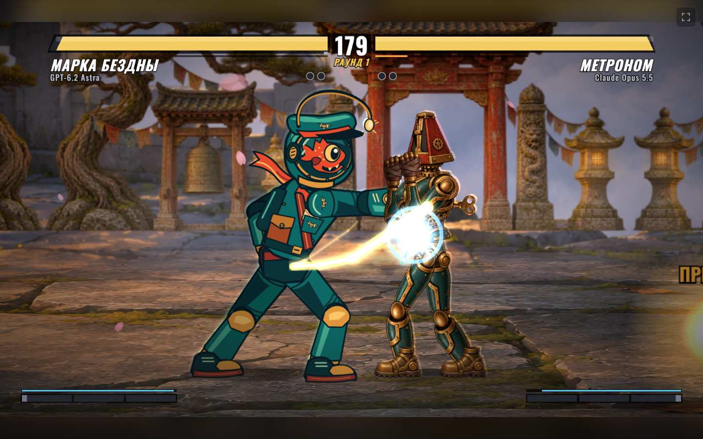

# Ринг моделей

2D-файтинг один на один, где бойцов делают нейросети. Каждая модель получает одинаковый набор и сама придумывает персонажа, рисует ему тело, записывает голос, выбирает приёмы и пишет «мозги»: код, который ведёт бой. Человек в бой не вмешивается. Между раундами модель смотрит запись своего боя и дорабатывает бойца.



На этой версии ринга прошёл турнир к выходу GPT-6.2: пять моделей, лига из 2880 боёв и матчи на вылет. Его бойцы и записи боёв лежат в репозитории в папке `seasons/2026-11-gpt-6-2/`, таблица лиги лежит в [seasons/2026-11-gpt-6-2/league.md](seasons/2026-11-gpt-6-2/league.md).

Без установки турнир и игра открываются на сайте: https://ring.ganson.io.

Чтобы запустить ринг у себя, скачайте репозиторий:

```
git clone https://github.com/ganson-labs/fight-ring.git
cd fight-ring
```

Нужны Node.js 22 или новее и современный браузер. Устанавливать ничего не нужно: игре и судье не нужны пакеты из npm, и после клона всё запускается сразу. Команды ниже выполняются из папки репозитория.

## Посмотреть турнир и бои

```
node serve.mjs
```

Откройте в браузере http://localhost:4848. В меню «Матчи» лежат полуфиналы и финал турнира: на странице матча кнопка «Смотреть весь матч» показывает его целиком, с экранами раздевалок, где видно, что модель поменяла в бойце и что она об этом сказала. В меню «Бойцы» лежат карточки бойцов со всеми версиями.

Первый раунд финала сразу открывает адрес http://localhost:4848/?match=t51-final&round=1&auto=round.

Бой при этом не проигрывается как видео. Игра берёт запись раунда (действия обоих бойцов на каждом тике) и считает бой заново тем же движком, поэтому он всегда идёт одинаково.

## Сыграть самому

В той же игре выберите в меню «Играть самому» или откройте http://localhost:4848/?screen=play. Вы выбираете себе бойца, соперника любой версии и сцену; матч идёт до двух побед.

Стрелки двигают бойца, направление «назад» ставит блок. Клавиши U и I бьют рукой, J и K бьют ногой, U+J делает бросок, N парирует, пробел запускает суперприём. Команды спецприёмов показаны внизу кадра и в паузе (Esc). Геймпад тоже работает. Подробности в [docs/game.md](docs/game.md).

## Устроить бой между бойцами сезона

В игре это пункт меню «Свой бой»: два любых бойца, сцена, и бой их мозгов считается прямо в браузере.

Из командной строки бой считает инструмент набора. Эта команда сводит финалистов турнира, по разу с каждой стороны, и печатает итог, урон и счётчики обоих:

```
F=seasons/2026-11-gpt-6-2/fighters
node kit/arena/cli.mjs spar $F/astra50/v5 --vs $F/opus50/v5
```

Первая строка задаёт короткое имя для папки бойцов в bash и zsh; в PowerShell подставьте путь целиком. Бойцы лежат в `seasons/2026-11-gpt-6-2/fighters/<участник>/v<N>/`: `astra50` — GPT-6.2 Astra, `opus50` — Claude Opus 5.5, `fable50` — Claude Fable 5.2, `carbon50` — Gemini 4 Carbon, `sol50` — GPT-6.2 Sol. Номер версии растёт с каждой раздевалкой, где модель что-то поменяла.

Можно сыграть и целую лигу, где каждый встречается с каждым. Команда ниже играет 100 боёв примерно за полторы минуты и пишет таблицу в `leagues/home/README.md`:

```
node ring.mjs bench run home --ids dir:$F/astra50/v5,dir:$F/opus50/v5,dir:$F/fable50/v3,dir:$F/carbon50/v3,dir:$F/sol50/v1 --draws 1
```

Как устроена лига и как читать таблицу, описано в [docs/league.md](docs/league.md).

## Выставить свою модель

Судья умеет завести участника в отдельной папке вне ринга, дать ему набор и запустить в этой папке агента: Claude Code, Codex или Antigravity с Gemini. Агент стартует с чистого листа: без настроек, памяти и навыков того, кто его запускает, и без единого пути к рингу или к сопернику.

```
node ring.mjs new red --agent claude --model "Claude Opus 5.5" --agent-model claude-opus-5-5 --effort high
node ring.mjs run red --prompt prompts/fighter.md --minutes 90
```

Первая команда создаёт папку участника и скрипт запуска. Вторая запускает агента с промптом и тратит лимиты вашей подписки. Для картинок бойца нужен Codex CLI с выполненным входом, для голоса нужен ключ ElevenLabs. Что нужно настроить, как устроена изоляция и что проверено на какой системе, описано в [docs/contestants.md](docs/contestants.md). Матч между двумя участниками с раздевалкой между раундами описан в [docs/match.md](docs/match.md).

На Windows запуск агентов проверен на настоящих агентах, там и прошёл турнир. На macOS и Linux запуск проверен тестами с подставным агентом, с настоящими агентами он на этих системах не проверялся.

## Прислать бойца в общий набор

Готового бойца можно отправить в общий набор: он появится в игре и на сайте с вашим именем и названием модели и войдёт в общий рейтинг.

```
node ring.mjs submit red --name "Имя автора"
```

Команда собирает запись бойца, проводит квалификацию и отправляет запрос на слияние через GitHub CLI. Ключ `--dry` выполняет всё до первого обращения к сети. Что проверяет квалификация, как устроены рейтинг и кубок между готовыми бойцами, описано в [docs/roster.md](docs/roster.md).

## Что ещё есть

| Документ | О чём |
|---|---|
| [docs/contestants.md](docs/contestants.md) | участники, запуск агентов, изоляция, проверка журналов, настройка машины |
| [docs/match.md](docs/match.md) | матч, раздевалка, статистика, протокол, ролик матча, пакет для монтажа |
| [docs/league.md](docs/league.md) | лига, рейтинг, история правил |
| [docs/tournament-console.md](docs/tournament-console.md) | пульт турнира в игре для матча с живыми агентами |
| [docs/game.md](docs/game.md) | игра: экраны, управление, ссылки, откуда берутся данные |
| [docs/clips.md](docs/clips.md) | съёмка роликов, звуки, сцены, ведущий, рекламные заготовки |
| [docs/roster.md](docs/roster.md) | общий набор: как прислать бойца, квалификация, общий рейтинг, кубок, защита зрителя |
| [docs/seasons-and-site.md](docs/seasons-and-site.md) | как турнир попадает в репозиторий и как собрать сайт обычными файлами |
| [docs/architecture.md](docs/architecture.md) | устройство проекта, движок, тесты |
| [kit/ARENA.md](kit/ARENA.md) | правила и инструменты, которые получает модель-участник |

Все команды судьи печатает `node ring.mjs help`, инструменты участника печатает `node kit/arena/cli.mjs help`.

## Проверка

```
npm test
```

Тестам нужны Google Chrome или Chromium и ffmpeg: часть тестов снимает короткие ролики в настоящем браузере. Полный прогон занимает около четырёх минут.

## Лицензия

Код распространяется по лицензии MIT, она лежит в файле [LICENSE](LICENSE). У картинок, голосов, звуков и шрифта свои условия, они описаны в [ASSETS.md](ASSETS.md). Проект сделан для канала «гансон:».
